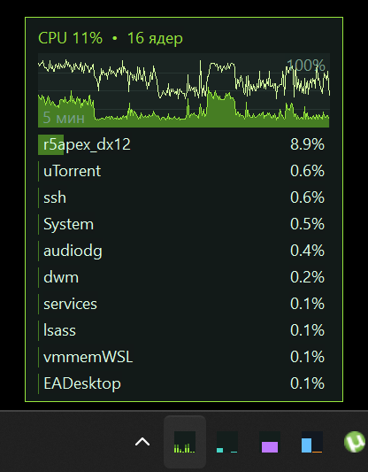
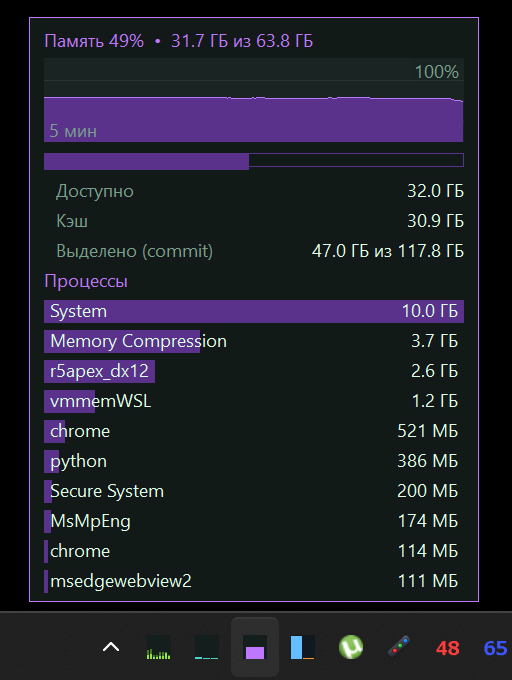
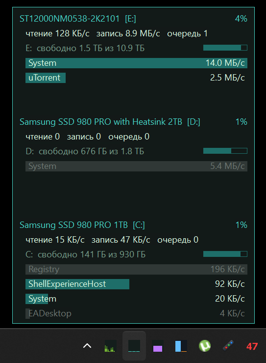
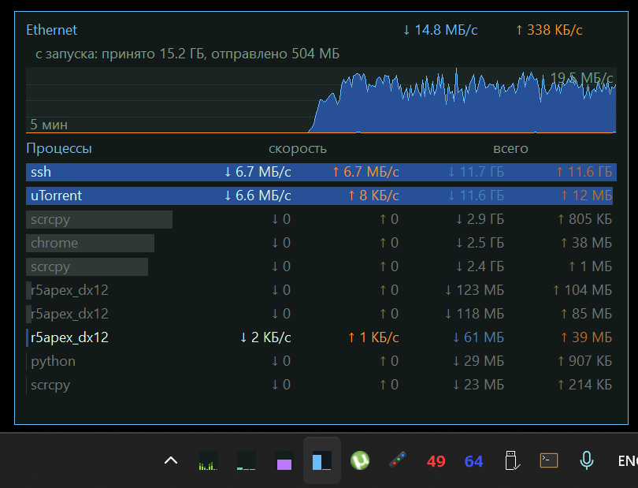

# iliz resmon

Крошечный монитор ресурсов для системного трея Windows: CPU, память, диски и сеть. Чистый WinAPI на C++, без CRT и сторонних библиотек: exe около 35 КБ, потребление памяти минимальное.

[English](README.md) | Русский

<p>
   
</p>

Интерфейс на русском или английском: язык выбирается по языку интерфейса Windows (русский для русской Windows, иначе английский).

## Возможности

- **CPU**: иконка со столбиком на каждое ядро (если ядер больше, чем пикселей, они группируются). Во всплывающем окне: график за 5 минут (средняя загрузка и самое загруженное ядро), топ процессов (по умолчанию 10).
- **Память**: занято/доступно, кэш, commit, график за 5 минут, топ процессов (по умолчанию 10) по приватному рабочему набору.
- **Диски**: по физическим устройствам с буквами томов (`Samsung SSD 970 [C: D:]`): активность, чтение/запись, очередь, свободное место; таблица топ процессов (по умолчанию 10) по дисковому трафику за сегодня: текущая скорость чтения и записи и объём прочитанного и записанного за сегодня (обнуляется в 00:00, завершившиеся процессы остаются серыми), с двухцветной полосой чтение/запись.
- **Сеть**: скорость приёма и отдачи, топ процессов (по умолчанию 10) по трафику с текущей скоростью и объёмом за сегодня (обнуляется в 00:00).
- **Видеокарта** (по умолчанию выключена, включается в конфигураторе): загрузка из счётчиков производительности `GPU Engine` (самый загруженный тип движка, как в диспетчере задач), а также занятая видеопамять (счётчики `GPU Adapter Memory` относительно объёма из DXGI, адаптеры сопоставляются по LUID). На иконке с бегущим графиком загрузка показана столбиками, видеопамять голубой линией; во всплывающем окне строка `Видеопамять: занято / всего (N%)`, график за 5 минут с обеими линиями и легендой, самые загруженные типы движков и топ процессов по видеопамяти. Видеопамять берётся у того адаптера, который сейчас нагружен. У встроенной графики (меньше 512 МБ выделенной памяти) показывается общая системная память. Права администратора не нужны.
- Процессы, выпавшие из топа, ещё 5 секунд показываются серым, чтобы успеть их разглядеть.
- Корректная работа при любом масштабе экрана (DPI-aware v2), правильное позиционирование всплывающих окон, в том числе для иконок в области скрытых значков.
- Автозапуск (галочка **Запускать с Windows** в конфигураторе) через `HKCU\Software\Microsoft\Windows\CurrentVersion\Run`, без прав администратора.

## Права администратора

Списки процессов по дискам и сети собираются через трассировку ядра (ETW), а она работает только с правами администратора. Без них программа показывает всё остальное: во всплывающем окне сети остаются итоги по адаптерам и пометка, что трафик по процессам требует прав администратора (та же пометка есть в подсказке и в меню), а таблица в окне дисков заполняется из счётчиков ввода-вывода процессов и называется «Процессы: весь I/O» (они учитывают и чтение из кэша, устройства и сеть). Пункт меню «Перезапустить от администратора» запускает копию с правами, и она сама закрывает экземпляр без прав.

Некоторые античиты (например, Easy Anti-Cheat) блокируют трассировку ядра, пока запущена игра. Программа повторяет попытку каждые 15 секунд и восстанавливается сама после выхода из игры.

## Настройки

Пункт меню **Настройки…** открывает `iliz_resmon_config.exe`: маленькое окно, где можно выбрать, какие иконки показывать в трее (CPU, память, диски, сеть, видеокарта), интервал обновления (0,5, 1 или 2 с), сколько строк процессов показывать во всплывающих окнах (от 3 до 15) и запускать ли программу вместе с Windows. Изменения применяются сразу, хотя бы одна иконка остаётся включённой.

Настройки хранятся в `iliz_resmon.ini` рядом с exe:

```ini
[tray]
cpu=1
mem=1
disk=1
net=1
gpu=0
interval_ms=1000
top_n=10
```

Если файла или ключа нет, иконки `cpu`/`mem`/`disk`/`net` включены, `gpu` выключена, `interval_ms` равен 1000 мс (допустимо 500, 1000 или 2000), а `top_n` равен 10 (от 3 до 15). `top_n` задаёт длину списков процессов CPU, памяти, дисков и сети; списки движков GPU и процессов по видеопамяти получают половину (5 при 10). Высота окон подстраивается. Конфигуратор записывает файл и посылает работающему iliz resmon оконное сообщение `iliz_resmon_reload`, тот перечитывает файл, заново добавляет только включённые иконки и перезапускает таймер с новым интервалом. Сообщение пропускается через UIPI, так что это работает и когда iliz resmon запущен от администратора. Ini не входит в архив релиза и указан в `preserve` в `iliz_updater.json`, поэтому обновления не сбрасывают настройки.

## Обновления

В zip релиза лежат `iliz_updater.exe` и `iliz_updater.json` из
[iliz_updater](https://github.com/takoyta/iliz_updater). Они должны лежать рядом с `iliz_resmon.exe`.

- При запуске и потом раз в 6 часов программа тихо проверяет релизы этого репозитория на GitHub. Сам апдейтер ходит в сеть не чаще раза в сутки (`check_interval_hours`).
- В меню трея есть пункт **Проверить обновления**. Если найдена новая версия, он превращается в **Обновить до vX.Y.Z**.
- Пункт открывает окно апдейтера: текущая и новая версия, список изменений. После подтверждения он скачивает zip, проверяет SHA-256, закрывает iliz resmon, заменяет файлы (при любой ошибке откатывает) и запускает программу снова с теми же правами.
- Если рядом с exe нет `iliz_updater.exe` (например, в локальной сборке), пункт меню не показывается.

Выпуск релизов описан в [RELEASING.md](RELEASING.md).

## Сборка

Нужны Visual Studio 2022 Build Tools с компонентом C++. Запустите `build.bat`: он собирает все `src\*.cpp` в `bin\iliz_resmon.exe`, а `config\config.cpp` (вместе с `src\nocrt.cpp`) в `bin\iliz_resmon_config.exe` и кладёт рядом `iliz_updater.json` (и `iliz_updater.exe` из `..\iliz_updater\bin`, если он есть), так что `bin\` готова к запуску. Если Build Tools установлены в другое место, задайте путь в переменной `VSINSTALL`.

## Устройство кода (`src/`)

| Файл | Назначение |
|---|---|
| `main.cpp` | Точка входа, окно, меню, единственный экземпляр, передача управления экземпляру с правами |
| `app.cpp` | Ежесекундный цикл: сбор данных, обработка, отрисовка |
| `cpu.cpp`, `mem.cpp`, `disk.cpp`, `net.cpp` | Сбор метрик |
| `procs.cpp` | Снимок процессов (`NtQuerySystemInformation`): топы по CPU, памяти, вводу-выводу |
| `etw.cpp` | Трассировка ядра: процессы по дискам и сети, автоматический перезапуск сессии |
| `history.cpp` | История за 5 минут, по секунде (байты / 16-битные коды) для графиков |
| `gpu.cpp` | Загрузка видеокарты через PDH и видеопамяти через PDH и DXGI (`pdh.dll` и `dxgi.dll` грузятся, только пока иконка GPU включена) |
| `sticky.cpp` | Выпавшие из топа строки, которые ещё показываются серым |
| `proctot.cpp` | Итоги процессов за день (сеть, диски, весь I/O): обнуляются в 00:00, сохраняются для завершившихся процессов |
| `trayicon.cpp` | Отрисовка иконок и работа с треем |
| `popup.cpp`, `views.cpp`, `draw.cpp`, `theme.h` | Всплывающие окна: размещение, содержимое, примитивы рисования, цвета |
| `autostart.cpp` | Проверка прав, перезапуск с правами |
| `settings.h` | Чтение и запись `iliz_resmon.ini`, сообщение о перечитывании и автозапуск (HKCU Run), общие с конфигуратором |
| `../config/` | `iliz_resmon_config.exe`: окно настроек (`config.cpp`, `config.rc`, манифест) |
| `lang.h`, `lang.cpp` | Строки интерфейса на английском и русском, общие с конфигуратором |
| `format.cpp` | Форматирование скоростей и размеров |
| `version.h`, `app.rc` | Версия (в одном месте) и ресурс VERSIONINFO |
| `iliz_updater_client.h` | Копия клиента iliz_updater без CRT: фоновая проверка, запуск обновления |
| `nocrt.cpp` | Сборка без CRT: точка входа, `memset`/`memcpy`/`memcmp`, окно с ошибкой при падении |

## Лицензия

[MIT](LICENSE)
